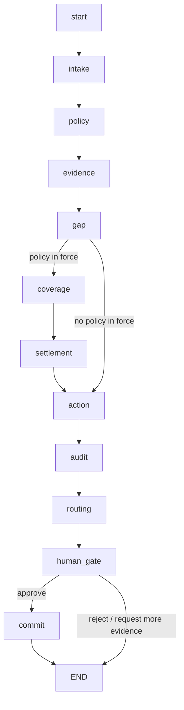

# The claim graph (T6.1)

One LangGraph state machine per claim (`thread_id` = claim id). Only `src/claimtower/orchestration/` imports LangGraph (ADR-0001); agents stay framework-free.
Run it: `python scripts/run_graph.py` (add `--mock-only`, `--claim CLM-0003`, `--decide approve --role senior_adjuster`, `--llm`, `--diagram`).
Test it: `tests/unit/test_orchestration.py` (every agent a mock) and `tests/integration/test_graph_flow.py` (the real agents on the synthetic claims).

## The flow



Any agent that fails parks the claim (`resolution_status = awaiting_human`) and the flow halts with the reason in the event log and in `RunStatus.halted_reason`.
An ownership violation is a bug and stops the run with `OwnershipViolation`. `start` clears an earlier gate state, so every (re)assessment begins at `assessing`.

## Which agents are real

| Node | Agent | Status | Task |
|---|---|---|---|
| intake | Intake | **YET TO IMPLEMENT (mock)** | T6.7 |
| policy | Policy | implemented (needs a policy library; the PAS is the mock adapter) | T3.5 |
| evidence | Evidence | implemented (needs a document store) | T2.4 |
| gap | Gap | implemented (rules; the model too when an `llm` is given) | T4.7 |
| coverage | Coverage | **YET TO IMPLEMENT (mock)** | T5.1 |
| settlement | Settlement | **YET TO IMPLEMENT (mock)** | T5.5 |
| action | Action | **YET TO IMPLEMENT (mock)** | T6.4 |
| audit | Quality & Audit | **YET TO IMPLEMENT (mock)** | T8.5 |
| routing | Supervisor routing | **YET TO IMPLEMENT (mock)** | T5.6 |
| commit | Claims / Recon adapters | **YET TO IMPLEMENT (mock)** | T6.5-T6.6 |

A **mock** (`orchestration/mocks.py`) returns the labelled fixture slice of the claim (`data/fixtures/<scenario>/<agent>.json`) and says so in its rationale:
`YET TO IMPLEMENT (mock, T5.1): the coverage agent will ... Returned the fixture of scenario S-01; nothing was computed.` For a claim without a fixture it returns
the owned fields at their defaults. A mock's output is illustrative: it is not derived from the real agents' output (it can cite other clause ids than the real
Policy agent), every event of a mock node has `mock = True`, and the gate lists the mock agents behind the dossier.

**Replacing a mock:** write the agent (it takes a `ClaimState`, returns a `StatePatch` of its owned fields), import it in `claimtower/composition.py`, add it to
`real` in `build_registry`, and remove its name from `_MOCKS`. The graph, the gate and the tests do not change; extend `test_graph_flow.py` with what the new agent adds.

## The human gate

The graph pauses at `human_gate` with a payload (tier, reason codes, required approver role, open questions, contradictions, evidence requests, coverage issues,
settlement, the mock agents). It resumes with a `HumanDecision`: `approve`, `reject` or `request_more_evidence`, a named reviewer and a role. A decision is
**refused** (the gate stays open and the payload carries `error`) when: the decision is not one of the three, the reviewer is anonymous, the role is unknown,
the role is below the claim's `required_approver_role`, or a reject / request has no reason. The system only recommends: an approval pays and denies nothing;
the (mock) commit step will instruct the Claims and Recon adapters when they exist.

## Using it from the API (see docs/api.md: the HTTP surface over exactly this)

```python
runner = ClaimRunner(build_registry(settings, document_store=store, policy_library=library, llm=llm))
runner.start(ClaimState(claim_id=...))            # -> RunStatus(phase: awaiting_human_decision | halted | completed)
runner.status(claim_id); runner.state(claim_id); runner.events_for(claim_id); runner.history(claim_id)
runner.decide(claim_id, HumanDecision(...))       # resume the gate
runner.reassess(claim_id, from_node="evidence")   # new evidence: nodes before `from_node` are not re-run
```

## Not done yet (and where it goes)

- **Incremental reassessment as a dependency map** (T6.2): `reassess(from_node=)` is the mechanism; `orchestration/dependencies.py` (which output depends on which input,
  and "skipped (unchanged)" in the run log) is still to do. The Evidence and Gap agents are already incremental inside their own nodes.
- **Persistent checkpoints and events:** the checkpointer and the event log are in memory (a restart loses them). The Gap agent's `GapMemory` must be checkpointed too,
  otherwise a restarted claim does a full (slower, not wrong) gap run.
- **Human gate extras** (T6.3): editing a recommendation and re-running settlement, RBAC from `configs/rbac.yaml` and the autonomy matrix, override reasons.
- **Duplicate and idempotency handling, retries, dead letters** (T6.6, T6.8): the adapters and their idempotency keys.
