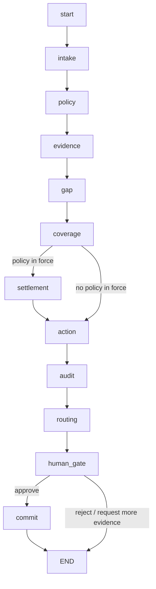

# The claim graph (T6.1)

One LangGraph state machine per claim (`thread_id` = claim id). Only `src/claimtower/orchestration/` imports LangGraph (ADR-0001); agents stay framework-free.
Run it: `python scripts/run_graph.py` (add `--mock-only`, `--claim CLM-0003`, `--decide approve --role senior_adjuster`, `--llm`, `--diagram`).
Test it: `tests/unit/test_orchestration.py` (every agent a mock) and `tests/integration/test_graph_flow.py` (the real agents on the synthetic claims).

## The flow



Any agent that fails parks the claim (`resolution_status = awaiting_human`) and the flow halts with the reason in the event log and in `RunStatus.halted_reason`.
An ownership violation is a bug and stops the run with `OwnershipViolation`. `start` clears an earlier gate state, so every (re)assessment begins at `assessing`.

## Which agents are real

| Node | Agent | Status | Task |
|---|---|---|---|
| intake | Intake | implemented (header from the notice of loss, consolidated checklist, exact policy lookup, registration in the claims system) | T6.7 |
| policy | Policy | implemented (needs a policy library; the PAS is the mock adapter) | T3.5 |
| evidence | Evidence | implemented (needs a document store) | T2.4 |
| gap | Gap | implemented (rules; the model too when an `llm` is given) | T4.7 |
| coverage | Coverage | implemented (decision table in the pack; the model reads cover/exclusion rows when an `llm` is given) | T5.1 |
| settlement | Settlement | implemented (the model reads amounts and rewords the explanation when an `llm` is given; the engine computes) | T5.5 |
| action | Action | implemented (planner + pack templates; the model rewords drafts, checked) | T6.4 |
| audit | Quality & Audit | implemented (deterministic quality checks; a failing report blocks the release to the gate) | T8.5 |
| routing | Supervisor routing | implemented (deterministic: the routing rules, no model) | T5.6 |
| commit | Claims / Recon adapters | implemented in the default API app (the claims and recon mocks behind the retrying dispatcher); a runner built without a commit service keeps the labelled mock | T6.6 |

A **mock** (`orchestration/mocks.py`) returns the labelled fixture slice of the claim (`data/fixtures/<scenario>/<agent>.json`) and says so in its rationale:
`YET TO IMPLEMENT (mock, T8.5): the audit agent will ... Returned the fixture of scenario S-01; nothing was computed.` For a claim without a fixture it returns
the owned fields at their defaults. A mock's output is illustrative: it is not derived from the real agents' output (it can cite other clause ids than the real
Policy agent), every event of a mock node has `mock = True`, and the gate lists the mock agents behind the dossier.

**Replacing a mock:** write the agent (it takes a `ClaimState`, returns a `StatePatch` of its owned fields), import it in `claimtower/composition.py`, add it to
`real` in `build_registry`, and remove its name from `_MOCKS`. The graph, the gate and the tests do not change; extend `test_graph_flow.py` with what the new agent adds.

## The human gate

The graph pauses at `human_gate` with a payload (tier, reason codes, required approver role, open questions, contradictions, evidence requests, coverage issues,
settlement, the mock agents). It resumes with a `HumanDecision`: `approve`, `edit`, `reject` or `request_more_evidence`, a named reviewer and a role. `edit` changes settlement INPUTS (`edits`: input name -> amount, with a reason): the engine calculates again, the gate opens again, and the override is recorded with who and why. `reject` needs the role the autonomy matrix names for `deny_claim` (enforced by `audit/guards.py`; a blocked attempt is an `action_denied` event); the role order comes from `configs/rbac.yaml` (`approval_order`). A decision is
**refused** (the gate stays open and the payload carries `error`) when: the decision is not one of the three, the reviewer is anonymous, the role is unknown,
the role is below the claim's `required_approver_role`, or a reject / request has no reason. The system only recommends: an approval pays and denies nothing;
the (mock) commit step will instruct the Claims and Recon adapters when they exist.

## Using it from the API (see docs/api.md: the HTTP surface over exactly this)

```python
runner = ClaimRunner(build_registry(settings, document_store=store, policy_library=library, llm=llm))
runner.start(ClaimState(claim_id=...))            # -> RunStatus(phase: awaiting_human_decision | halted | completed)
runner.status(claim_id); runner.state(claim_id); runner.events_for(claim_id); runner.history(claim_id)
runner.decide(claim_id, HumanDecision(...))       # resume the gate
runner.reassess(claim_id, from_node="evidence")   # new evidence: nodes before `from_node` are not re-run
```

## Not done yet (and where it goes)

- **Incremental reassessment as a dependency map** (T6.2, built: see below; this line is the original note): `reassess(from_node=)` is the mechanism; `orchestration/dependencies.py` (which output depends on which input,
  and "skipped (unchanged)" in the run log) is still to do. The Evidence and Gap agents are already incremental inside their own nodes.
- **Persistent checkpoints and events:** the checkpointer and the event log are in memory (a restart loses them). The Gap agent's `GapMemory` must be checkpointed too,
  otherwise a restarted claim does a full (slower, not wrong) gap run.
- **Human gate extras** (T6.3): editing a recommendation and re-running settlement, RBAC from `configs/rbac.yaml` and the autonomy matrix, override reasons.
- **Duplicate and idempotency handling, retries, dead letters** (T6.6, T6.8): the adapters and their idempotency keys.

## Incremental re-assessment (T6.2)

`orchestration/dependencies.py` declares which parts of the claim state each node reads. When a claim is re-assessed from a node, a later node whose inputs are the same as the inputs it left behind after its last successful run is **skipped** and the run log says `skipped (unchanged)`; a node whose inputs changed re-runs and its `agent_finished` event carries `rerun_reason` (the fields that changed). The node a person asks for always runs. `intake` and `evidence` are never skipped (their real input is the stored documents; both are incremental inside). `GET /claims/{id}/status` lists `skipped_nodes` of the latest assessment. A test clears every field a node does not declare and checks the node's output does not change, so the declarations cannot silently drift from the code.

Limits: what the policy system or the wording library says is outside the claim state, so a changed policy needs `reassess(from_node="policy")`; the Gap agent also reads the coverage issues (for the counterfactual scenarios), so the first re-assessment always re-runs it, which also fills in scenarios that were empty on the first run.

## Audit trail and decision pack (T8.3)

`audit/trail.py` keeps an **append-only, hash-chained** trail (one JSON line per record, in a file when the server has a store directory: `audit-trail.jsonl` next to the documents, or `CLAIMTOWER_AUDIT`). Each record carries the hash of the one before and its own hash, so an edited, removed or reordered record breaks the chain at that point (`GET /claims/{id}/trail` says whether it is intact). There is no update or delete operation.

What it records: `claim_created` (the state a claim started with), a `state_patch` for every change (who, the full values written, the version it made, whether the agent was a mock, the digest of its inputs, and the model calls made meanwhile with model, prompt name and prompt version), and every run event (human decisions with reviewer, role, reason and edits, commits, denied attempts, skipped nodes, failures). The claim state at any version can be rebuilt **from the trail alone** (`AuditTrail.reconstruct`), and a test checks the rebuilt state equals the live one, at every version, after an edit and an approval.

`audit/explain_pack.py` renders the **decision pack** from the trail alone: the decision and who made it, the recommendation, the coverage issues, the calculation with its trace, the evidence with verbatim quotes and document hashes, the policy wording used, the open questions, the actions and drafts, how the assessment was made (agent by agent, with model and prompt versions), the quality report, and the integrity check. `GET /claims/{id}/decision-pack` returns it as Markdown, or PDF with `?format=pdf`.

Limits: the hash chain detects tampering inside the file; keeping the file from being replaced wholesale (write-once storage, signing the head hash, an external anchor) is a deployment matter. The default server keeps its store in a temporary directory, so start it with `--store` to keep the trail between runs. The live model calls of a run are recorded by name and version, not their text.
